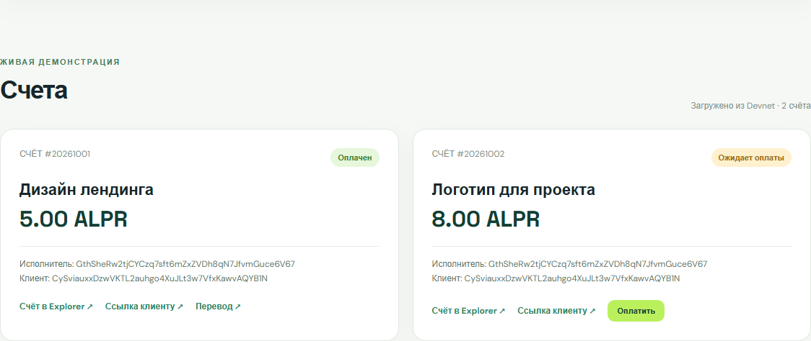

# Solana и InvoiceFlow — Бимано Алишер

Учебный Web3-проект для РК1. За восемь недель я прошёл путь от Devnet-перевода и Rust CLI до программы на Anchor, токена Token 2022 и веб-прототипа **InvoiceFlow**.

## InvoiceFlow

Исполнитель создаёт счёт с названием работы, суммой и адресом клиента. Эти данные записываются в отдельный PDA в Solana Devnet. Клиент может оплатить счёт учебным токеном ALPR. Программа переводит токены и меняет статус счёта в одной транзакции. На странице видны реальные данные из сети.



Демонстрация в Devnet:

| Счёт | Статус | Подтверждение |
|---|---|---|
| Дизайн лендинга · 5 ALPR | Оплачен | [Счёт](https://explorer.solana.com/address/4PH11X1rdkwqsmKKyV8dc7ATAM9YiGn9M7CXomB8WDVn?cluster=devnet) · [Транзакция оплаты](https://explorer.solana.com/tx/L6BTirqHmcs8dBqwzRrArw6aiSfBAgYzZzqDzU16KE3GRUoJqxoRJdyHskoQeXLNz51e6AFimGuRJFsmtNHuFmM?cluster=devnet) |
| Логотип для проекта · 8 ALPR | Ожидает оплаты | [Счёт](https://explorer.solana.com/address/DFGJFvyRhgMBX5ezN6GMWg4oVU7PdpZZSUwizksgdkSy?cluster=devnet) |

ALPR выпущен только для обучения. Он не равен доллару и не имеет денежной стоимости. Это прототип в Devnet, не сервис для настоящих платежей.

## Запуск

```bash
cd assignments/week4-8
npm ci
npm run dev
```

Открой адрес, который покажет Vite. Публичные счета видны без кошелька. Для создания или оплаты нужен Phantom с сетью Devnet, а для оплаты — учебные ALPR и Devnet SOL на комиссию. Программа и её исходник находятся в [папке недель 4–8](assignments/week4-8/).

## Что сделано по неделям

| Неделя | Результат |
|---|---|
| 1 | Учебные кошельки, Devnet SOL и первый перевод |
| 2 | Разбор транзакций и перевод с Memo |
| 3 | Rust CLI для счёта, перевода и конвертации lamports |
| 4 | Первая программа Solana на Rust |
| 5 | Счётчик на Anchor с PDA |
| 6 | Профиль с PDA и обновлением данных |
| 7 | Токен ALPR через Token 2022 |
| 8 | InvoiceFlow: создание счёта, оплата и веб-страница |

Исходники недель 1–3 и подтверждения находятся в [assignments](assignments/). Отчёты по каждой неделе — в [personalized](personalized/). Публичные адреса и подписи транзакций собраны в `assignments/evidence/` и `assignments/week4-8/evidence/`.

## Технологии

Rust, Anchor, Solana Devnet, Token 2022, JavaScript, Vite, Phantom. Приватные ключи и папки сборки в репозиторий не входят.
